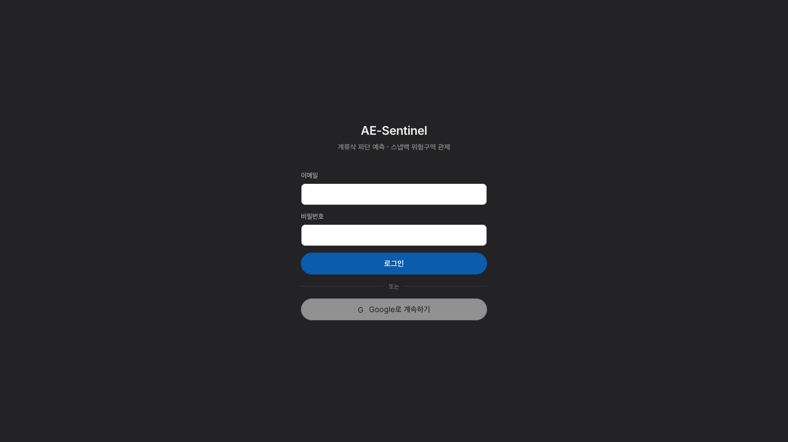
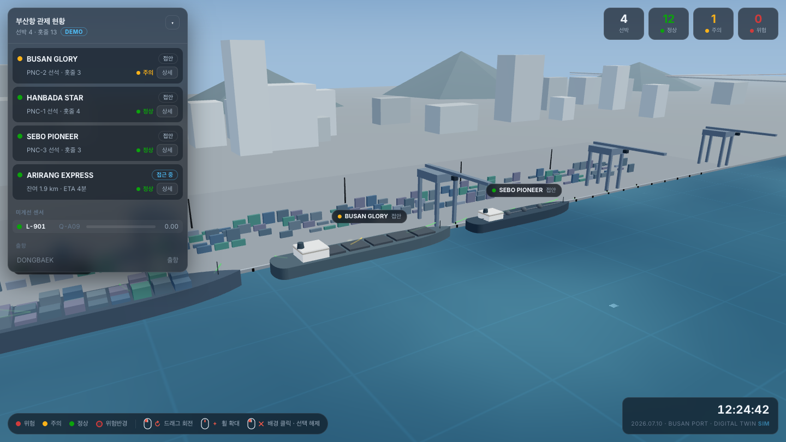
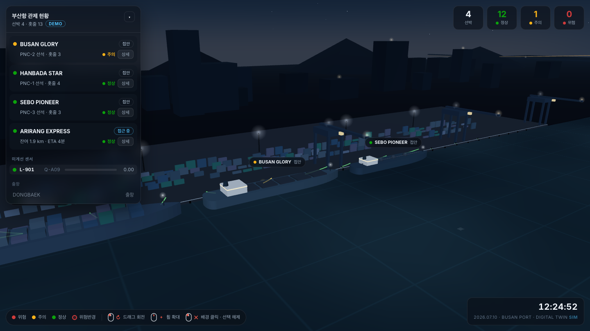
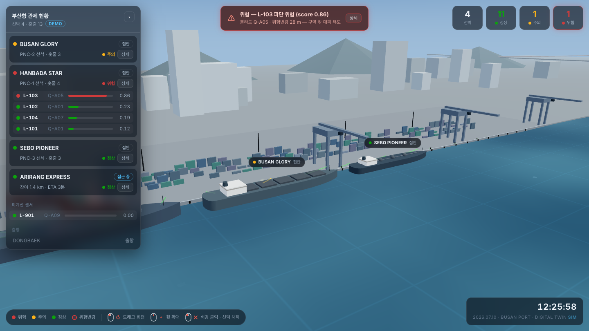
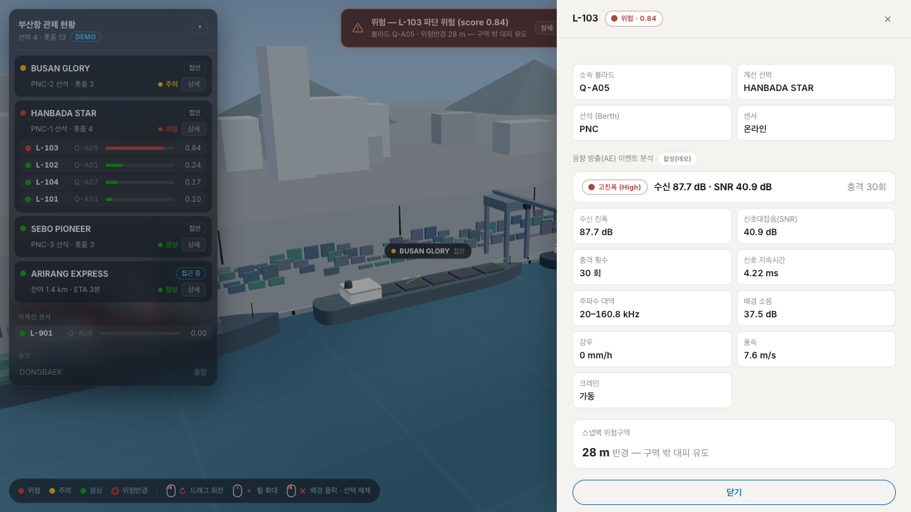
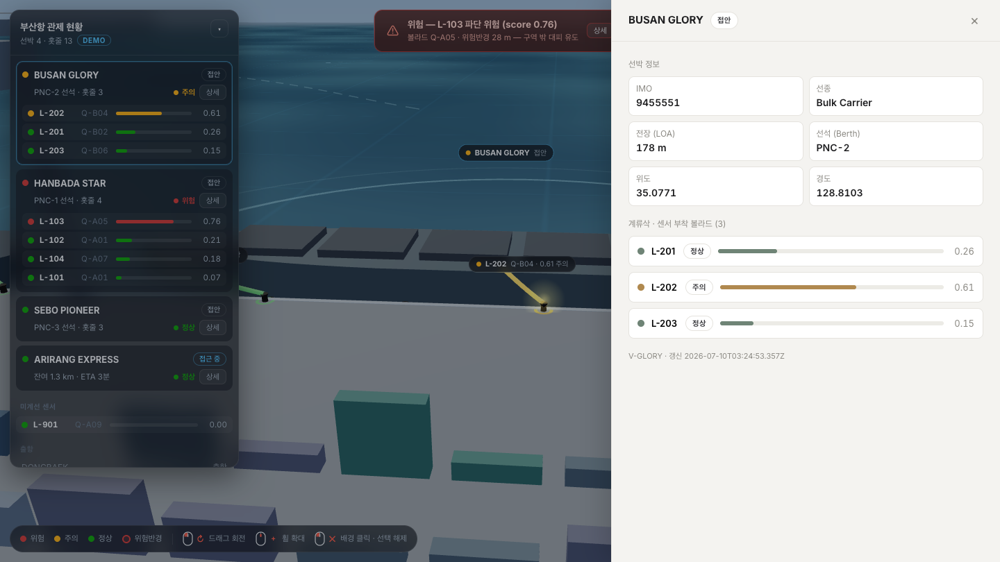
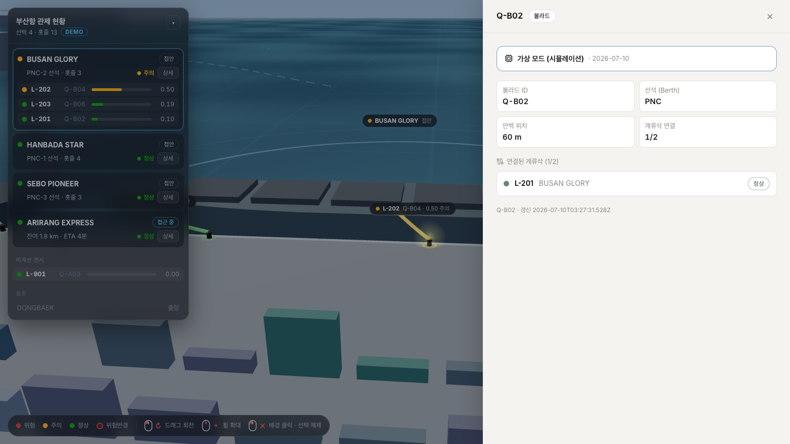
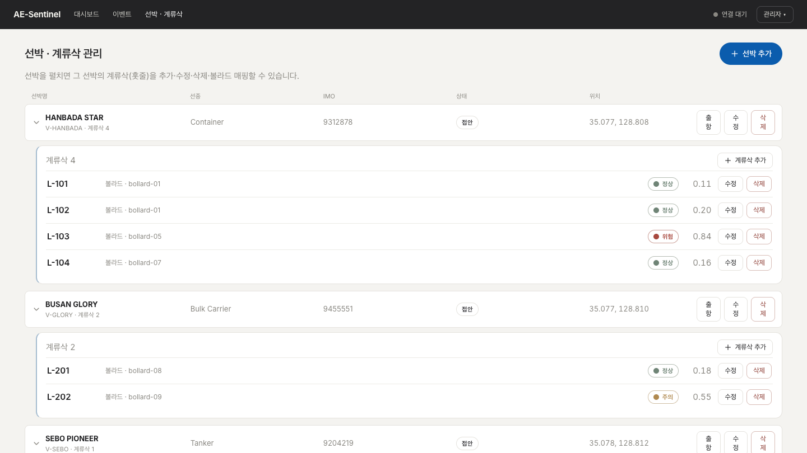
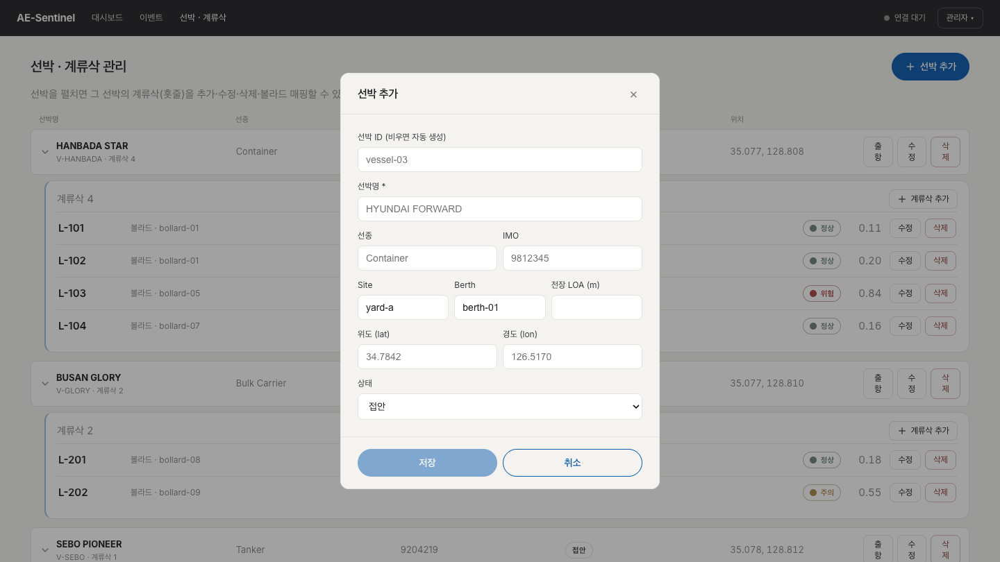
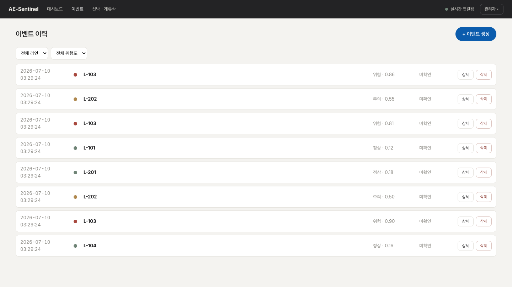

# AE-Sentinel Frontend

음향 방출(AE) 기반 계류삭(홋줄) 파단 예측·스냅백 위험구역 실시간 **관제 대시보드**.
부산항 배경의 3D 디지털 트윈 위에서 선박 접안·계류삭 상태·볼라드 매핑·위험반경을
실시간으로 보여주고, 선박/계류삭/볼라드 관리와 이벤트 이력을 제공한다.

## 기술 스택

| 영역 | 사용 기술 |
|---|---|
| 프레임워크 | React 18 + TypeScript + Vite |
| 3D 트윈 | three.js · @react-three/fiber · @react-three/drei (커스텀 셰이더 하늘/바다) |
| 라우팅 | react-router-dom v6 |
| 인증 | AWS Amplify (Amazon Cognito · Google 소셜 로그인) |
| 실시간 | WebSocket (`ws-risk-message.v1`) — 위험도 갱신 실시간 반영 |
| 아이콘 | lucide-react |

## 화면 구성 (라우트)

| 경로 | 화면 | 인증 |
|---|---|---|
| `/login` | 로그인 (Cognito · Google) | 공개 |
| `/` | 관제 대시보드 — 부산항 디지털 트윈 | 필요 |
| `/vessels` | 선박 · 계류삭 관리 (CRUD + 접안/출항) | 필요 |
| `/events` | 이벤트 이력 (필터·상세·확인) | 필요 |
| `/demo` | 공개 시연 — 백엔드/로그인 없이 시뮬레이션 데이터로 트윈 구동 | 공개 |

---

## 화면 갤러리 (와이어프레임)

> 아래 캡처는 실제 렌더링 화면이다. 트윈/상세 화면은 `/demo`(시뮬레이션),
> 관리 화면은 목업 데이터로 캡처했다.

### 인증

| 로그인 |
|---|
|  |
| Cognito 이메일/비밀번호 + Google 소셜 로그인. |

### 관제 대시보드 — 디지털 트윈

현재 시각에 따라 낮/밤이 자동 전환된다. 계류삭 색상(위험 빨강 · 주의 노랑 · 정상
녹색), 볼라드 매핑, 위험 시 스냅백 위험반경과 상단 경보 배너, 반투명 글래스 HUD
(좌상단 관제 리스트 · 우상단 KPI · 우하단 시계 · 좌하단 범례·조작 힌트).

| 낮 (day) | 밤 (night) |
|---|---|
|  |  |

| 위험 상태 — 경보 배너 + 스냅백 위험반경 |
|---|
|  |

### 상세 슬라이드오버 (3D 트윈에서 클릭)

| 계류삭 상세 (LineDetail) | 선박 상세 (VesselDetail) |
|---|---|
|  |  |
| 실시간 상태 + 3D 홋줄 + **AE 이벤트 분석**(수신 진폭·SNR·충격 횟수·신호 유형·환경 공변량) + 스냅백. 실 이벤트가 있으면 실시간, 없으면 합성값. | 선박 제원(IMO·선종·LOA·선석·위치) + 계류삭/센서 부착 볼라드 목록. |

| 볼라드 상세 (BollardDetail) |
|---|
|  |
| 센서 온보딩 상태(실센서 DEVICE / 가상 VIRTUAL / 미연동 PENDING) + 연결 계류삭(최대 2). 온보딩과 계류삭 연결을 분리해 표시. |

### 관리 (CRUD)

| 선박 · 계류삭 관리 | 선박 추가 폼 |
|---|---|
|  |  |
| 선박을 펼치면 계류삭(볼라드 매핑·위험도) 추가/수정/삭제, 접안/출항 처리. | 선박 제원 입력 모달. 계류삭·볼라드 폼도 동일 패턴. |

| 이벤트 이력 |
|---|
|  |
| 라인·위험도 필터, 이벤트별 위험도·점수·확인(Ack) 상태, 상세(ML 분석) 진입. |

---

## 디렉토리 구조

```text
src/
  auth/           # AuthProvider, RequireAuth, Login (Cognito/Amplify)
  components/     # AppLayout, TopNav, VesselDetail/Form, LineForm,
                  #   BollardDetail/Form, Modal
  features/       # Dashboard, TwinDemo, VesselsManage, EventsHistory,
                  #   LineDetail, EventDetail, RopeScene
  twin/           # 디지털 트윈: PortScene(3D), Hud, DigitalTwin, layout,
                  #   palette, daylight, demo, port 윈도 피처
  lib/            # api, types, config, amplify, useWebSocket, acoustic
public/  wireframes/(screens 캡처)  tests/
```

## 주요 컴포넌트

- **`twin/PortScene.tsx`** — R3F 3D 씬: 안벽·볼라드·선박·계류삭·크레인·컨테이너
  야드·부산항대교, 낮/밤 셰이더, 위험반경·비콘, 클릭 상호작용(선박/볼라드/계류삭).
- **`twin/DigitalTwin.tsx`** — 씬 + HUD 조합, 선택/포커스 카메라(선박 선택 시 안벽
  쪽에서 계류삭을 정면으로 보는 시점), 상세 슬라이드오버 오케스트레이션.
- **`twin/Hud.tsx`** — 반투명 관제 HUD(선박·계류삭 리스트, KPI, 경보 배너, 범례).
- **`features/LineDetail.tsx`** — 계류삭 실시간 상세 + AE 이벤트 특징량(v2) 표시.
- **`components/BollardDetail.tsx`** — 볼라드 센서 온보딩 + 계류삭 연결.
- **`components/AppLayout.tsx`** — REST 초기 로드(lines·vessels·bollards·summary)
  + WebSocket 구독으로 라인 위험도 실시간 갱신.

## 데이터 흐름

```text
IoT(AE 이벤트) → Backend(추론·저장) ──REST──▶ AppLayout 초기 로드
                                    └─WebSocket─▶ 라인 위험도 실시간 갱신 → 트윈 색상/배너
사용자 클릭(선박/볼라드/계류삭) → 상세 슬라이드오버(REST getEvent 등)
```

## 실행

```bash
npm install
npm run dev       # 개발 서버 (http://localhost:5173)
npm run build     # 타입체크 + 프로덕션 번들
npm run preview   # 번들 미리보기
```

- 공개 시연: `http://localhost:5173/demo` (백엔드·로그인 불필요).
  낮/밤 고정 파라미터: `/demo?tod=13`(낮) · `?tod=23`(밤).
- 환경 변수(`.env`): `VITE_API_BASE`, `VITE_WS_URL`, `VITE_USER_POOL_ID`,
  `VITE_USER_POOL_CLIENT_ID`, `VITE_COGNITO_DOMAIN`, `VITE_AWS_REGION`,
  `VITE_ENABLE_GOOGLE`. (`.env.example` 참조)

## 계약 기준

- docs canonical source: `../docs` (`AWS-PBL-6/docs`)
- 이벤트/추론/실시간 계약: `../docs/packages/contracts/schemas/`
  (`iot/ae-feature-event.v2.json`, `ml/inference-request.v2.json`,
  `websocket/ws-risk-message.v1.json`)
